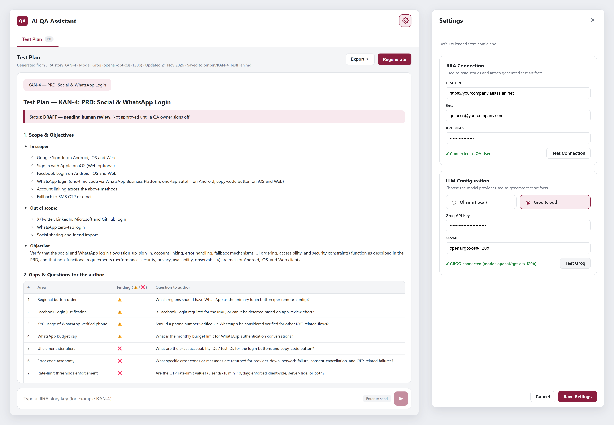
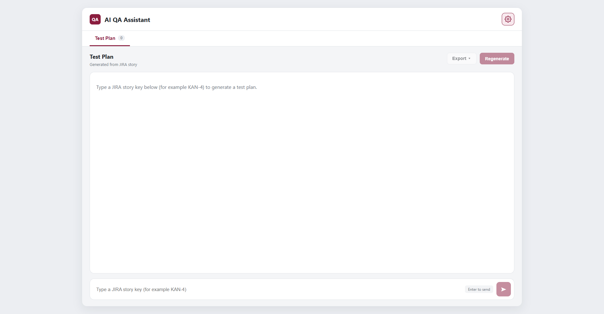
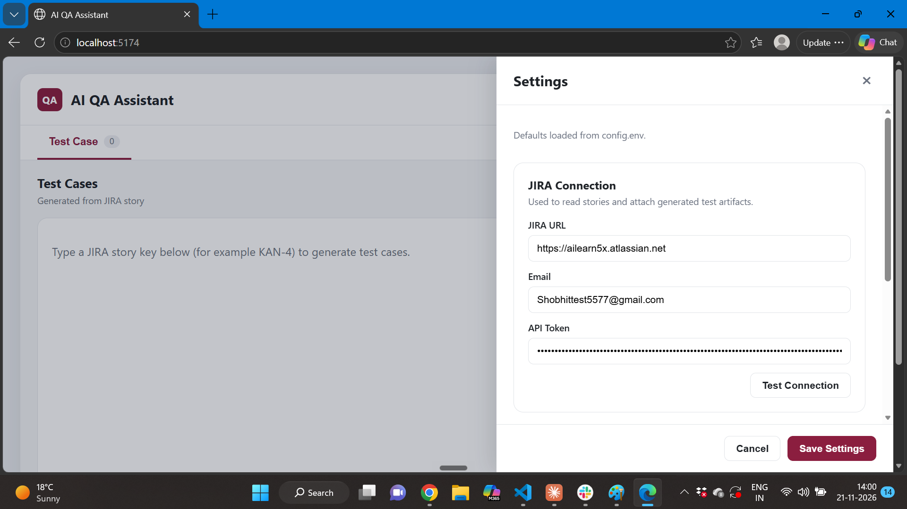

# QA AI agents

Two local web apps that turn a JIRA story into QA work. Both use the same design and the same Settings drawer for JIRA and the LLM (Groq or Ollama):

- [QA TestPlan AI agent](#qa-testplan-ai-agent): JIRA story -> test plan (Markdown, exported to PDF)
- [QA TestCase AI agent](#qa-testcase-ai-agent): JIRA story -> test cases (table, exported to Excel)

---

## QA TestPlan AI agent

A local web app that turns a JIRA story into a test plan. Type a story key (for example `KAN-4`), and the agent fetches the story with its subtasks, linked issues, comments and acceptance criteria from JIRA, sends them to an LLM (Groq or Ollama) with [TestPlan_Template.md](Chapter_04_AI_Agent_Basics/VIBE_CODING/01_Intelligent_TestPlan_AIAgent/02_Plan/Template/TestPlan_Template.md), shows the plan on the page and saves it as `output/<KEY>_TestPlan.md`.

📁 Source: [01_Intelligent_TestPlan_AIAgent/](Chapter_04_AI_Agent_Basics/VIBE_CODING/01_Intelligent_TestPlan_AIAgent/)

### 🎨 Design

The target design: the Test Plan page (left) and the Settings drawer (right).

### 🖥️ Built app

**Test Plan page:** type a JIRA story key in the box at the bottom and press Enter. **Export** downloads the plan as PDF or Markdown, and **Regenerate** runs the same story again.

**Generated test plan:** the result for story `KAN-4` (PRD: Social & WhatsApp Login) with Groq `openai/gpt-oss-120b`. The tab shows the number of test scenarios (20), and the line under the title shows the model, the date and the file the plan was saved to. Scroll inside the plan to see all sections.

**Settings drawer:** opened with the gear icon. It is pre-filled from `config.env`, has the JIRA connection (URL, email, API token) and the LLM provider (Groq or Ollama), and a test button for each. Changes apply when you click **Save Settings**.

### 📋 Test plan sections

1. Scope & Objectives | 2. Gaps & Questions for the author | 3. Test Scenarios | 4. Test Data & Environment | 5. Risks & Assumptions | 6. Entry / Exit criteria | 7. Resource Allocation | 8. Timelines, Sprint Details | Human Review Gate

Every plan starts as **DRAFT — pending human review** and is not approved until a QA owner signs off. Anything the story does not say is written as `Insufficient information to determine.`, and inferred details are marked `Inference (low confidence)`.

---

## QA TestCase AI agent

A local web app that turns a JIRA story into test cases. Type a story key (for example `KAN-4`), and the agent fetches the story with its parent, subtasks and linked issues from JIRA, sends them to an LLM (Groq or Ollama) with [TESTCASE_PROMPT.md](Chapter_04_AI_Agent_Basics/VIBE_CODING/03_Intelligent_TestCase_AIAgent/02_Plan/Prompt/TESTCASE_PROMPT.md), shows the test cases in a table and exports them to Excel.

📁 Source: [03_Intelligent_TestCase_AIAgent/](Chapter_04_AI_Agent_Basics/VIBE_CODING/03_Intelligent_TestCase_AIAgent/)

### 🎨 Design

The target design: the Test Case page (left) and the Settings drawer (right).

### 🖥️ Built app

**Test Case page:** type a JIRA story key in the box at the bottom and press Enter. **Export** downloads the Excel file, and **Regenerate** runs the same story again.

**Generated test cases:** the result for story `KAN-4` (PRD: Social & WhatsApp Login) with Groq `openai/gpt-oss-120b`. The tab shows the count (9), each row has a TC ID like `TC_KAN_SocialSignUp_001`, and Test Type and Priority are shown as tags. Scroll the table sideways to see the remaining columns.

**Settings drawer:** opened with the gear icon. It is pre-filled from `config.env`, has the JIRA connection (URL, email, API token) and the LLM provider (Groq or Ollama), and a test button for each.

### 📋 Output columns

TC ID | Module | Test Scenario | Test Case Title | Test Type | Priority | Preconditions | Test Steps | Test Data | Expected Result | Actual Result | Status | Build / Version | Comments

`Status` is always `Not Executed`, and `Actual Result` and `Build / Version` stay blank until the tests are run. A second sheet, **Clarification Log**, lists the gaps and open questions found in the story.
