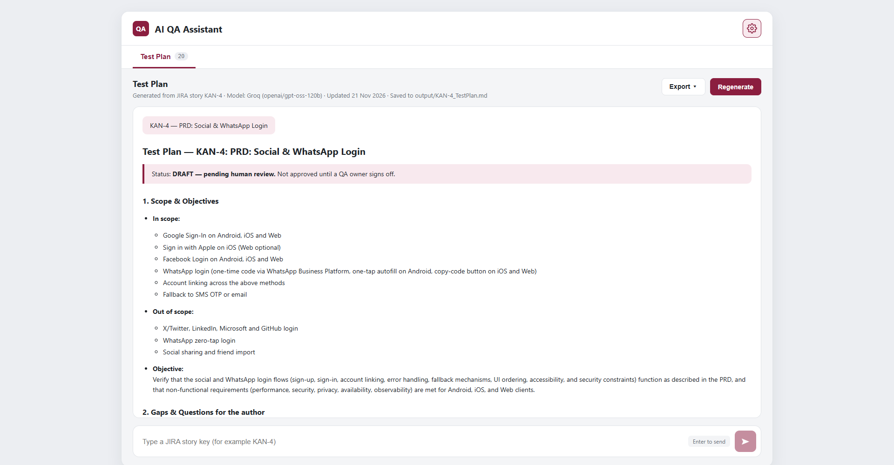
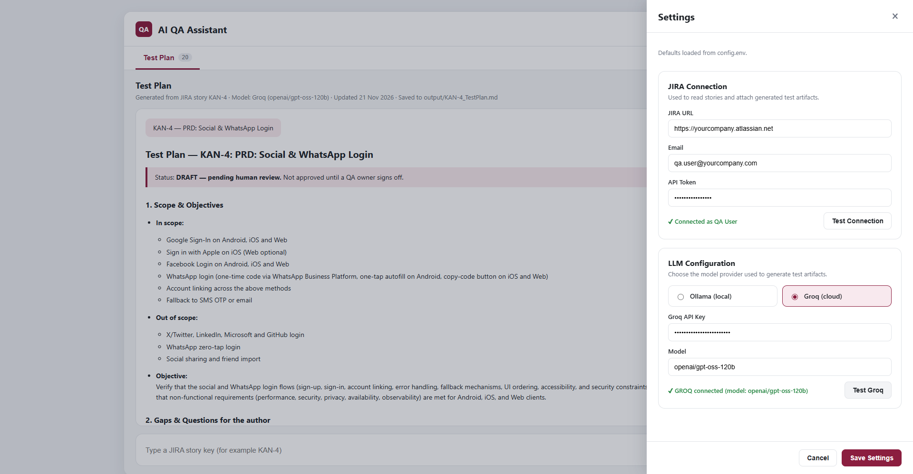
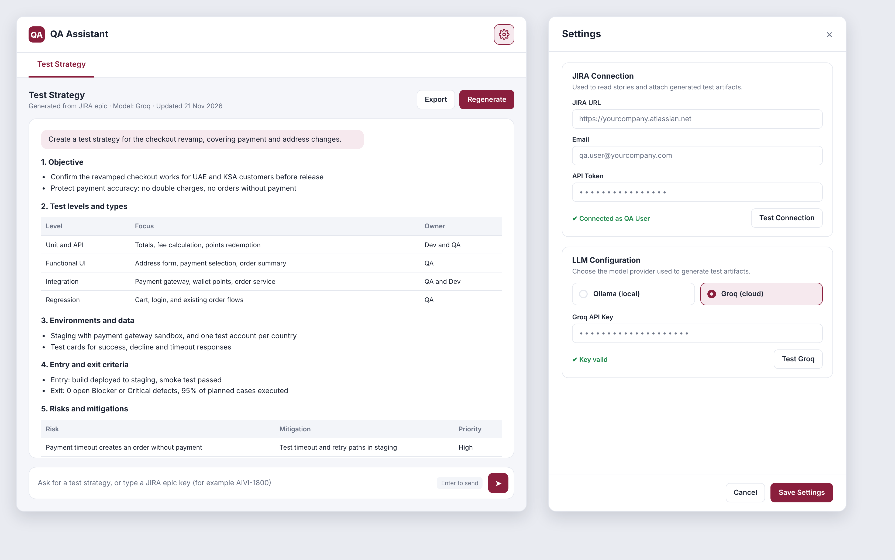
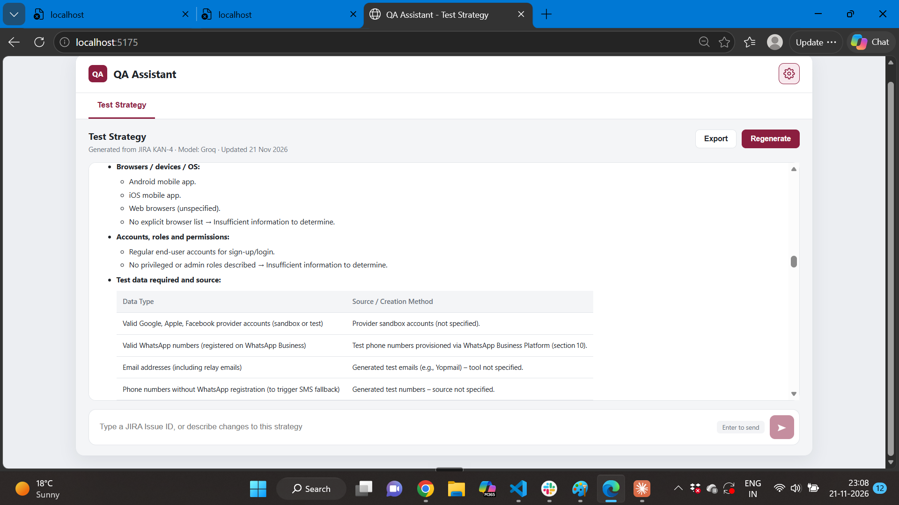
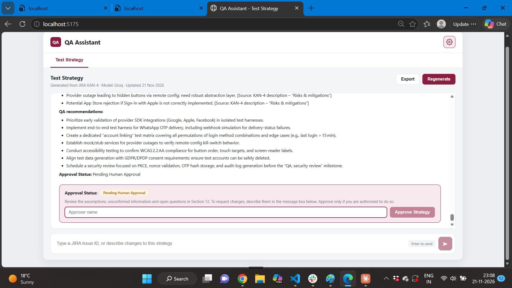
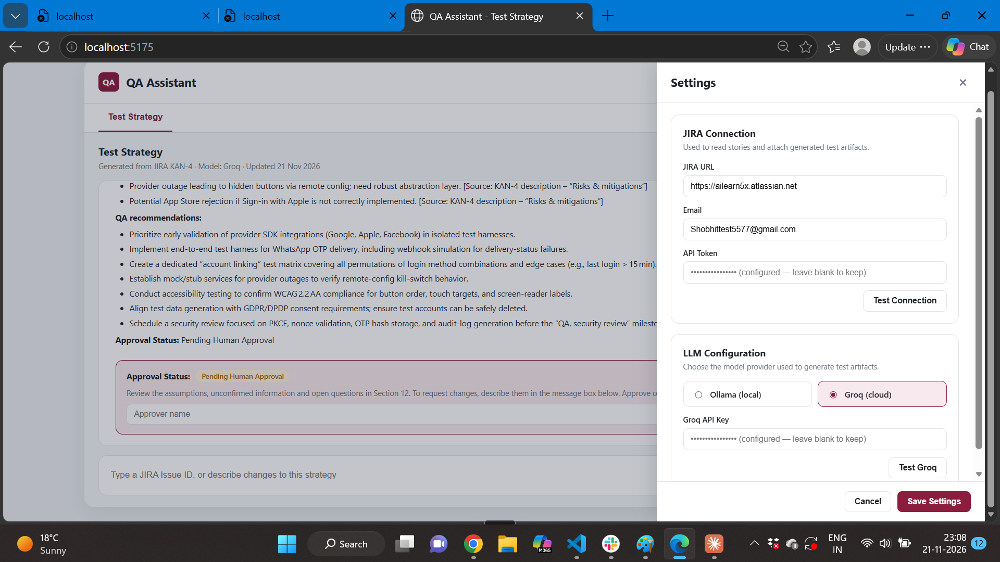
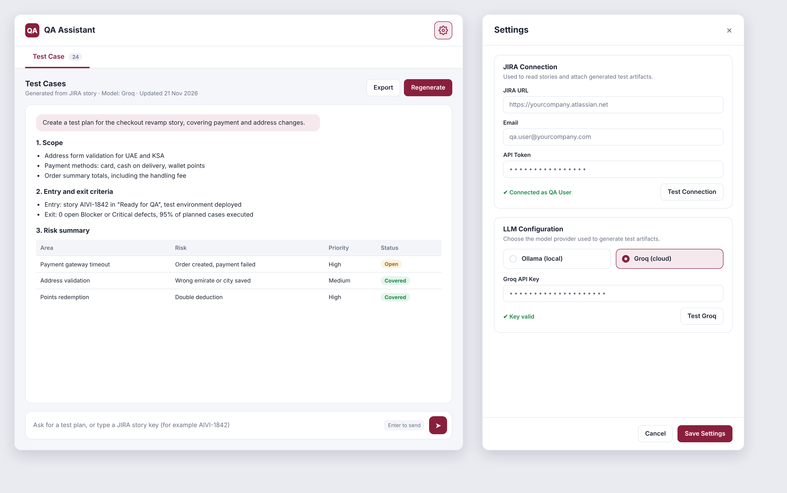
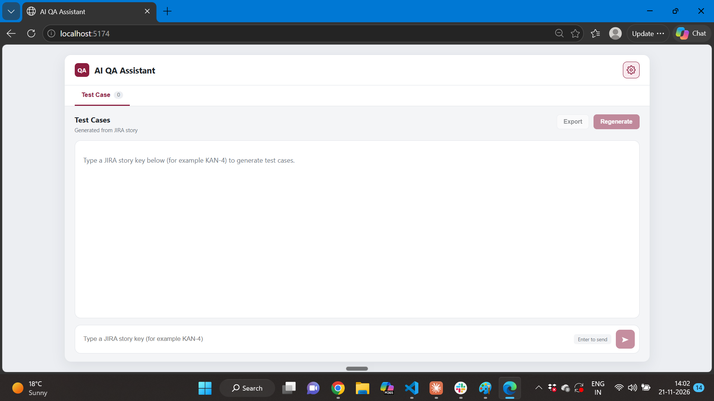
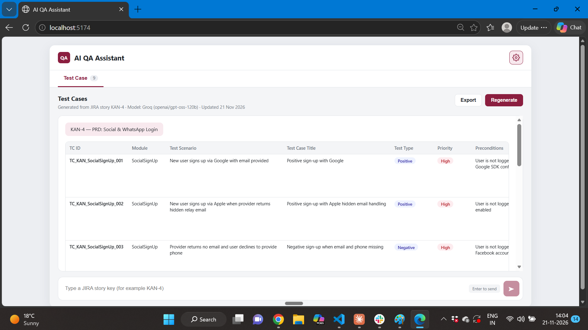

# QA AI agents

Three local web apps that turn a JIRA story into QA work. All use the same design and the same Settings drawer for JIRA and the LLM (Groq or Ollama):

- [QA TestPlan AI agent](#qa-testplan-ai-agent): JIRA story -> test plan (Markdown, exported to PDF)
- [QA TestStrategy AI agent](#qa-teststrategy-ai-agent): JIRA story -> evidence-based test strategy with a human approval gate (Markdown and PDF)
- [QA TestCase AI agent](#qa-testcase-ai-agent): JIRA story -> test cases (table, exported to Excel)

---

## QA TestPlan AI agent

A local web app that turns a JIRA story into a test plan. Type a story key (for example `KAN-4`), and the agent fetches the story with its subtasks, linked issues, comments and acceptance criteria from JIRA, sends them to an LLM (Groq or Ollama) with [TestPlan_Template.md](Chapter_04_AI_Agent_Basics/VIBE_CODING/01_Intelligent_TestPlan_AIAgent/02_Plan/Template/TestPlan_Template.md), shows the plan on the page and saves it as `output/<KEY>_TestPlan.md`.

📁 Source: [01_Intelligent_TestPlan_AIAgent/](Chapter_04_AI_Agent_Basics/VIBE_CODING/01_Intelligent_TestPlan_AIAgent/)

### 🎨 Design

The target design: the Test Plan page (left) and the Settings drawer (right).


### 🖥️ Built app

**Test Plan page:** type a JIRA story key in the box at the bottom and press Enter. **Export** downloads the plan as PDF or Markdown, and **Regenerate** runs the same story again.


**Generated test plan:** the result for story `KAN-4` (PRD: Social & WhatsApp Login) with Groq `openai/gpt-oss-120b`. The tab shows the number of test scenarios (20), and the line under the title shows the model, the date and the file the plan was saved to. Scroll inside the plan to see all sections.



**Settings drawer:** opened with the gear icon. It is pre-filled from `config.env`, has the JIRA connection (URL, email, API token) and the LLM provider (Groq or Ollama), and a test button for each. Changes apply when you click **Save Settings**.



### 📋 Test plan sections

1. Scope & Objectives | 2. Gaps & Questions for the author | 3. Test Scenarios | 4. Test Data & Environment | 5. Risks & Assumptions | 6. Entry / Exit criteria | 7. Resource Allocation | 8. Timelines, Sprint Details | Human Review Gate

Every plan starts as **DRAFT — pending human review** and is not approved until a QA owner signs off. Anything the story does not say is written as `Insufficient information to determine.`, and inferred details are marked `Inference (low confidence)`.

---

## QA TestStrategy AI agent

A local web app that turns a JIRA story into a feature-specific, risk-based test strategy. Type a story key (for example `KAN-4`), and the agent fetches the story with its comments, parent, linked issues and text attachments from JIRA, sends them to an LLM (Groq or Ollama) with [TestStrategy_Template.md](Chapter_04_AI_Agent_Basics/VIBE_CODING/02_Intelligent_TestStrategy_AIAgent/02_Plan/Template/TestStrategy_Template.md), shows the strategy on the page and saves it as `02_Plan/Output/<KEY>_TestStrategy.md` and `<KEY>_TestStrategy.pdf`. Built from [RICEPOT_PROMPT.md](Chapter_04_AI_Agent_Basics/VIBE_CODING/02_Intelligent_TestStrategy_AIAgent/02_Plan/Prompt/RICEPOT_PROMPT.md).

📁 Source: [02_Intelligent_TestStrategy_AIAgent/](Chapter_04_AI_Agent_Basics/VIBE_CODING/02_Intelligent_TestStrategy_AIAgent/)

### 🎨 Design

The target design: the Test Strategy page (left) and the Settings drawer (right).



### 🖥️ Built app

**Generated test strategy:** the result for story `KAN-4` (PRD: Social & WhatsApp Login) with Groq `openai/gpt-oss-120b`. Every statement cites its JIRA source, and gaps are written as `Insufficient information to determine.` **Export** downloads the strategy as Markdown or PDF, and **Regenerate** runs the same story again.



**Human review and approval gate:** every strategy starts as **Pending Human Approval**. Type requested changes in the message box to update the strategy (the status resets to pending), or enter the approver name and click **Approve Strategy**. The Markdown and PDF files are rewritten with the new status.



**Settings drawer:** opened with the gear icon. It is pre-filled from `config.env`, has the JIRA connection (URL, email, API token) and the LLM provider (Groq or Ollama), and a test button for each. The API token and Groq key stay on the backend: the page only shows whether they are configured.



### 📋 Test strategy sections

1. Feature Overview | 2. Scope and Objectives | 3. Risk and Impact Assessment | 4. Testing Coverage | 5. Test Approach | 6. Environment and Test Data | 7. Dependencies and Assumptions | 8. Defect Management | 9. Entry and Exit Criteria | 10. Roles, Schedule and Deliverables | 11. Reporting and Metrics | 12. Human Review and Approval Gate

The backend checks that every template heading is present and in order before saving. Section 12 lists assumptions, information that could not be confirmed, blocking and non-blocking questions, risks and QA recommendations.

### ▶️ Run

```bash
cd Chapter_04_AI_Agent_Basics/VIBE_CODING/02_Intelligent_TestStrategy_AIAgent/03_Implementation/src
npm install
npm run dev   # API on http://127.0.0.1:3003, UI on http://localhost:5175
```

On the Groq free tier (8,000 tokens per minute) the strategy is generated in three parts with short waits between them, so one run takes about 2 minutes.

---

## QA TestCase AI agent

A local web app that turns a JIRA story into test cases. Type a story key (for example `KAN-4`), and the agent fetches the story with its parent, subtasks and linked issues from JIRA, sends them to an LLM (Groq or Ollama) with [TESTCASE_PROMPT.md](Chapter_04_AI_Agent_Basics/VIBE_CODING/03_Intelligent_TestCase_AIAgent/02_Plan/Prompt/TESTCASE_PROMPT.md), shows the test cases in a table and exports them to Excel.

📁 Source: [03_Intelligent_TestCase_AIAgent/](Chapter_04_AI_Agent_Basics/VIBE_CODING/03_Intelligent_TestCase_AIAgent/)

### 🎨 Design

The target design: the Test Case page (left) and the Settings drawer (right).



### 🖥️ Built app

**Test Case page:** type a JIRA story key in the box at the bottom and press Enter. **Export** downloads the Excel file, and **Regenerate** runs the same story again.



**Generated test cases:** the result for story `KAN-4` (PRD: Social & WhatsApp Login) with Groq `openai/gpt-oss-120b`. The tab shows the count (9), each row has a TC ID like `TC_KAN_SocialSignUp_001`, and Test Type and Priority are shown as tags. Scroll the table sideways to see the remaining columns.



**Settings drawer:** opened with the gear icon. It is pre-filled from `config.env`, has the JIRA connection (URL, email, API token) and the LLM provider (Groq or Ollama), and a test button for each.


### 📋 Output columns

TC ID | Module | Test Scenario | Test Case Title | Test Type | Priority | Preconditions | Test Steps | Test Data | Expected Result | Actual Result | Status | Build / Version | Comments

`Status` is always `Not Executed`, and `Actual Result` and `Build / Version` stay blank until the tests are run. A second sheet, **Clarification Log**, lists the gaps and open questions found in the story.
